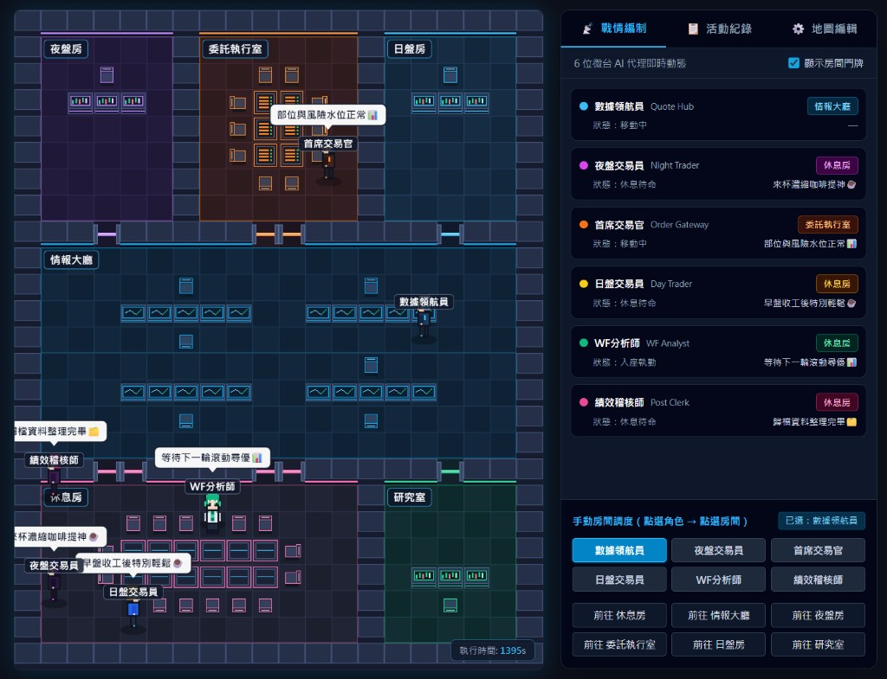

# Cyberpunk Pixel Office（事件驅動多代理像素戰情室）

> **預設搭載「微台指期貨戰情室（`PRESET=tmf` / `quant-trading`）」主題樣板 — 100% 業務邏輯與視覺引擎解耦，可透過單一環境變數或 JSON 樣板一鍵切換至任何多代理（Multi-Agent）協作場景。**

本專案基於開源專案 **[BTCx100/pixel-office](https://github.com/BTCx100/pixel-office)**（源自 `piraminet/pixel-office` 與 Pablo Delucca 之 `pixel-agents` 概念）進行深度重構與資料驅動化改造；所有美術圖檔（辦公室底圖與 6 位賽博龐克角色 Sprite Sheet）與繁體中文控制面板皆為 **100% 專案自製（由 `scripts/` 腳本程序化生成）**，無第三方付費圖塊授權限制。



---

## 核心架構：為什麼它是 100% 通用型引擎？

我們把**「外部業務邏輯（如金融交易）」與「視覺渲染／空間尋路引擎」**徹底切開：

### 1. 引擎層（`cyberpunk-pixel-office`）：完全不認得特定業務程式碼

`cyberpunk-pixel-office` 本身不含任何交易或特定領域邏輯，只負責三件事：

1. **資料驅動的空間與角色定義（Data-Driven Config）**
   - **空間與房間定義（`/app/data/map.json`）**：辦公室有幾個房間、叫什麼名字、哪裡是地板／牆壁／門／椅子（`collision: 0 | 1 | 2 | 3`）、每個房間的對接座位（`handoffSeat`）與面板標題（`scene`），全部由 `map.json` 決定，並可直接透過 `dashboard.html` 網頁視覺化拖拉修改。
   - **角色與閒置台詞定義（`/app/data/agents.json`）**：裡面住哪幾位 Agent、叫什麼名字、職稱、主題色、駐守房間（`homeRoom`），以及**角色在執勤／休息時的自言自語台詞（`idleLines.post` / `idleLines.rest`）**，全部抽離至 `agents.json`，達成引擎零寫死業務字串。
2. **極簡通用的事件接收協定（Generic Command Webhook）**
   - 只要任何外部系統對它發送一個標準 HTTP POST（同時相容通用 `x/y/state/message` 與 `tileX/tileY/sitAfter/msg` 欄位）：
     ```http
     POST /api/agent/2/command
     Content-Type: application/json

     {
       "action": "move",
       "room": "委託執行室",
       "x": 8,
       "y": 4,
       "state": "sit",
       "message": "入座簽核：委託 BUY filled✅"
     }
     ```
   - 伺服器就會自動驗證並校準目標房間的可行走／座椅座標、寫入活動紀錄（`pixel_actions.jsonl`），並交由前端演出。
3. **前端自動尋路與動畫狀態機（Canvas Engine）**
   - 前端只管把角色從目前座標沿著走廊與自動感應門洞（A* 尋路）走過去、自動找椅子入座（`sit`）、冒出頭頂對話氣泡（`message`），以及在閒置時依據 `agents.json` 的 `idleLines` 隨機走動說閒話。

---

### 2. 外部系統只要發 HTTP POST，就能拿來演任何場景

正因為它是標準的 HTTP 事件驅動（Event-Driven），除了預設接在 `broker-adapter`（微台指期貨量化交易戰情室）之外，同一套容器隨時可以接在任何多代理系統上：

- **量化交易戰情室（預設 Preset：`PRESET=tmf` / `quant-trading`）**：
  - 串接 `broker-adapter`：行情中樞報價、日夜盤策略巡航、委託閘道簽核、Walk-Forward 尋優與盤後對帳。
- **n8n 自動化工作流（例如 `ai-podcast` / `podcast-publisher`）**：
  - `Agent #0`（選題編輯）抓到 RSS 新聞 $\rightarrow$ 走去錄音室找 `Agent #1`（雙人主播）合成語音 $\rightarrow$ 再走去交給 `Agent #2`（社群小編）發佈 IG / Threads。
- **LLM Multi-Agent 協作（CrewAI / LangGraph / AutoGen / Cursor Agents）**：
  - PM Agent、Architect Agent、Coder Agent、QA Agent、SecOps Agent 在不同房間傳遞 PR、跑測試與修 Bug。
- **DevOps / SRE 監控中心（`PRESET=sre-noc`）**：
  - 接 GitHub Actions、Sentry 或 Datadog Webhook，有告警時值班工程師角色立刻衝進「戰情機房」入座處理。

### 3. 與外部業務系統的三層拆分邊界（以微台交易系統為例）

| 層級 | 所在倉庫 / 路徑 | 職責定位 |
| :--- | :--- | :--- |
| **通用戰情室引擎**<br>(Generic Engine) | 本倉庫 (`ai-20240303/cyberpunk-pixel-office`)<br>(`ghcr.io/ai-20240303/cyberpunk-pixel-office`) | **完全通用**。只認得 `map.json`、`agents.json` 與 `POST /api/agent/:id/command`，不依賴任何特定業務。 |
| **業務轉接外掛**<br>(Domain Bridge Plugin) | 業務端倉庫（如 `n8n-workflow` 的 `ai-trading-view/execution/plugins/pixel_office_bridge.py`） | **業務專屬導演**。唯一同時知道「業務事件（如 `burst_delta` / `Quote Hub`）」以及「角色要走去哪間房」的選配轉接層。 |
| **核心業務系統**<br>(Core Domain) | 業務端主程式（如 `broker_adapter.py` 或 n8n Workflow） | **純粹執行業務**。只負責拋出領域生命週期事件（`on_session_start`、`on_order_result` 等），不知道外面接的是什麼 HUD。 |

---

## 主題場景樣板（Presets）：預設微台指期貨，支援一鍵切換與自行擴充

本專案內建 Preset 樣板載入機制，**預設 Preset 為目前的「微台指期貨戰情室（`PRESET=tmf`，別名 `quant-trading`）」**：

### 預設微台指期貨樣板（`sample-data/*.tmf.json`）

首次掛載空 Volume（或設定 `FORCE_PRESET=1`）時，系統會自動從 `sample-data/map.tmf.json` 與 `sample-data/agents.tmf.json` 複製 6 個房間與 6 位微台期貨 AI 角色（含專屬閒置台詞 `idleLines`）至 `/app/data/`：

| ID | 角色名稱 | 對應職責 | 預設房間 (`homeRoom`) | 賽博龐克造型與主題色 |
|----|----------|----------|-----------------------|----------------------|
| `0` | **數據領航員** (`Quote Hub`) | Shioaji 即時行情中樞，每 60s `⏱️` 心跳進入盤房報價 | `情報大廳` | 電光青護目鏡 + 銀白科技短髮 + 訊號天線 |
| `1` | **夜盤交易員** (`Night Trader`) | 微台夜盤巡航 Worker (`burst_delta_night`) | `夜盤房` | 霓虹紫光學義眼 + 暗夜連帽戰術夾克 |
| `2` | **首席交易官** (`Order Gateway`) | 統一委託閘道，成交／拒單即時走訪盤房回報 | `委託執行室` | 雷射橘紅瞄準鏡 + 鈦金重裝裝甲背心 |
| `3` | **日盤交易員** (`Day Trader`) | 微台日盤巡航 Worker (`burst_delta_day`) | `日盤房` | 全息青色眼鏡 + 太陽金短髮 + 鈷藍極客西裝 |
| `4` | **WF分析師** (`WF Analyst`) | Walk-Forward 雙軌獨立滾動尋優 (`wf-runner`) | `研究室` | 矩陣綠數據鏡片 + 生化綠挑染 + 銀白研究風衣 |
| `5` | **績效稽核師** (`Post Clerk`) | 收盤 `post-session-pipeline` 對帳與滑價歸因 | `研究室` | 合成波粉紫護目鏡 + 雙馬尾耳機 + 稽核制服 |

### 如何自行擴充與切換新的 Preset？

只需在 `sample-data/` 目錄下新增對應名稱的兩個 JSON 樣板檔（例如 `podcast-studio` 或 `dev-team`）：

1. **`sample-data/map.<preset>.json`**：定義場景標題（`scene.title`、`scene.panelSubtitle`、`scene.restRoom`）、房間區塊（`rooms`）與碰撞矩陣（`collision`）。可直接用 `dashboard.html` 畫好房間後匯出保存。
2. **`sample-data/agents.<preset>.json`**：定義 6 位角色的 `name`、`role`、`homeRoom`、`themeColor` 與閒置台詞 `idleLines: { "post": [...], "rest": [...] }`。

接著可透過以下任一方式一鍵切換主題場景：

- **方式 A：透過環境變數啟動（Docker / `.env`）**
  ```ini
  # 預設為 tmf（亦支援別名 quant-trading）
  # 未來自行擴充後可改為 PRESET=podcast-studio 或 PRESET=dev-team
  PRESET=tmf
  FORCE_PRESET=1
  ```
- **方式 B：透過 REST API 動態熱切換**
  ```bash
  # 查詢目前啟用與可用的 Presets
  curl http://localhost:19001/api/presets

  # 熱切換並重置為指定 Preset（例如 tmf / quant-trading / podcast-studio）
  curl -X POST http://localhost:19001/api/preset \
    -H "Content-Type: application/json" \
    -d '{"preset": "tmf"}'
  ```

---

## 快速啟動（Docker Compose 常駐服務）

在倉庫根目錄執行：

```bash
docker compose up -d --build pixel-office
```

- **戰情室畫面**：`http://localhost:19001/`
- **房間與碰撞編輯器**：`http://localhost:19001/dashboard.html`

---

## 重新生成自製美術素材

若調整了配色或角色細節，可直接執行內建零依賴生成腳本：

```bash
# 重新生成 640x800 賽博龐克戰情室底圖 (assets/oficina.png)
node scripts/generate_cyberpunk_office.js

# 重新生成 6 位賽博龐克角色 Sprite Sheet (assets/characters/char_0~5.png)
node scripts/generate_cyberpunk_characters.js
```

詳細連動事件與時間軸請見 [`PLAY.md`](PLAY.md)。

---

## 致謝與原始來源（Credits & Upstream Attribution）

- **原始專案來源（Upstream Repository）**：[**BTCx100/pixel-office**](https://github.com/BTCx100/pixel-office)（forked from `piraminet/pixel-office`，靈感源自 Pablo Delucca 的 `pixel-agents`）。
- **本倉庫改造內容**：
  - 打造 **100% 通用型、REST 事件驅動的多代理虛擬辦公室引擎**，將空間配置、角色屬性與閒置台詞（`idleLines`）全面抽離至 JSON 資料層，並內建微台指期貨預設樣板（`PRESET=tmf`）與可擴充 Preset 架構。
  - 以零依賴 Node.js 程序化腳本（`scripts/generate_cyberpunk_office.js`、`scripts/generate_cyberpunk_characters.js`）100% 重新繪製 `640 × 800` 賽博龐克戰情室底圖與 6 位角色 Sprite Sheet，完全移除對第三方付費／外部圖塊之依賴。
  - 全面改寫為繁體中文戰情室控制面板（含戰情編制、即時活動紀錄、手動房間調度與 HiDPI 2x 畫布渲染）。
  - 封裝為跨架構 Docker Image（`ghcr.io/ai-20240303/cyberpunk-pixel-office:latest`），支援空 Volume 自動初始化、Preset 熱切換與 REST API 房間座標防呆校準。
